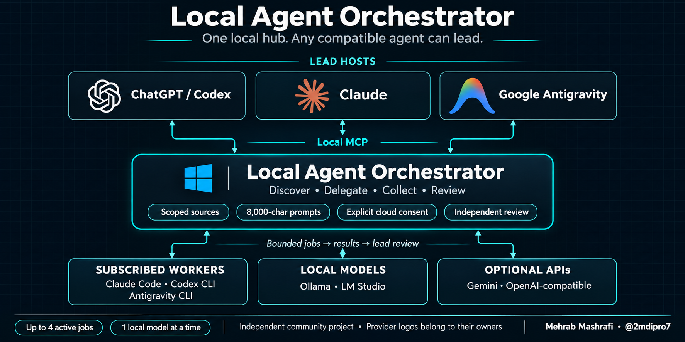

# Local Agent Orchestrator

[Download for Windows](https://github.com/2mdipro7/local-agent-orchestrator/releases) · [Setup help](HOST-CONNECTIONS.md) · [MIT license](LICENSE)

Connect your AI apps so one can delegate tasks to the others. Local Agent Orchestrator runs on your Windows PC and connects Claude, Codex, Antigravity, local models and supported APIs through one task interface.

For example, your lead assistant can ask Claude to draft a proposal from your notes and another worker to check a separate requirements list. It collects the responses, reviews them and prepares the final result. You can also submit tasks directly from the desktop app.

The lead chooses the models and decides which outputs to accept. The orchestrator keeps the requests, results and review records together. Independent jobs can run at the same time; total time and cost still depend on the work and providers you choose.

## Get started

1. Install the provider apps and command-line tools you want to use, then sign in with your own accounts. For local inference, install a model in Ollama or LM Studio and start its local server.
2. Download the Windows setup file and choose **Install for this user**. Leave automatic connections enabled for Claude Desktop, Claude Code, Codex and Antigravity.
3. Fully quit and reopen those apps. Open **Local Agent Orchestrator** from the Start menu.
4. Open **Models**, select **Refresh models**, then test the model you want to use.
5. Give your lead a specific task, or use **Run task** to choose a model, provide instructions and attach relevant files. Review the returned output before accepting it.

The installer needs no administrator access. It adds the host connections and preserves existing settings, reporting any conflicts. It does not install provider software, sign you in, supply subscriptions or API credits, or download models. Each host's own approval settings still apply. See [connection help](HOST-CONNECTIONS.md) if an app cannot find the orchestrator.

## Model status

Select a model and choose **Test selected model**. The app sends a short arithmetic prompt with no attached files. Cloud tests ask before using your account or API allowance.

| Status | Meaning |
|---|---|
| **✓ Last response tested** (green) | A response test passed on this PC with the current saved settings. |
| **Untested** | No matching test has passed yet, or settings have changed. |
| **Testing…** | A test is queued or running. |
| **Failed** | The latest test or a later task failed. Select the row for details. |
| **Unavailable / Unsupported** | The provider could not be discovered, or this entry does not support the text test. |

The green tick survives an app restart. Changing provider settings or saved credentials clears it, and a later failed request removes it. It records a past successful response, not a guarantee of current quota or account access. Changes made outside the app, such as switching a CLI account, require a new test. Some providers do not report the exact model identity.

## Supported providers

| Provider | What you can use |
|---|---|
| Claude Code | Existing CLI sign-in for text tasks |
| Codex | Existing ChatGPT CLI sign-in for text tasks |
| Antigravity | Existing CLI sign-in for text tasks |
| Ollama and LM Studio | Installed local models for text and supported image input |
| Gemini API | Text, image input and image generation with a supported model and your API key |
| OpenAI-compatible API | Text, image input and image generation through a compatible hosted or local endpoint |

Claude, Codex and Antigravity can each lead through a compatible MCP connection. Other MCP-compatible apps can connect too; web-only chats need a supported local bridge. OpenCode can lead, but its worker execution is not supported yet.

**Codex workers currently require CLI `0.169.0-alpha.11.1`, its model cache and a ChatGPT sign-in.** Other worker versions stop before inference. A compatible Codex host can still lead independently of that worker restriction. Provider access depends on your installed tools, account and selected model.

Image input lets a model read an image. Image generation requires a configured image-capable API or compatible local service. No image-generation models are bundled.

## Task controls

- Up to four active jobs, with one local-model request at a time.
- An 8,000-character limit for the complete authored prompt, including instructions, supplied excerpts and acceptance criteria.
- Only selected files from the task folder enter a request. Check attachments for private information before sending them to a cloud provider.
- Cloud, API and subscription requests require your authorization to use the configured account.
- Workers return responses or image artifacts. They cannot edit your project, run commands, delegate further or approve their own output.
- Completed work stays pending until the lead records a review.

This is an unsigned Windows x64 preview for attended use. Worker restrictions are application controls, not operating-system isolation. Saved API keys use Windows encryption; prompts, results and history remain local files accessible to your Windows user. Read [SECURITY.md](SECURITY.md) for the data-handling details.

## Development and documentation

[Build from source and contribute](CONTRIBUTING.md) · [Host connections](HOST-CONNECTIONS.md) · [Validation details](TEST-RESULTS.md) · [Release notes](CHANGELOG.md)

Uninstall through Windows Installed apps. Saved jobs, settings, keys and host connection entries are preserved; remove those separately when retiring the app.

Created and maintained by [Mehrab Mashrafi (@2mdipro7)](https://github.com/2mdipro7) · [Portfolio](https://2mdipro7.github.io/).

Source code is [MIT licensed](LICENSE). External providers, runtimes and models retain their own terms; see [third-party notices](THIRD-PARTY-NOTICES.txt). Provider names and logos identify integrations, not endorsement.
